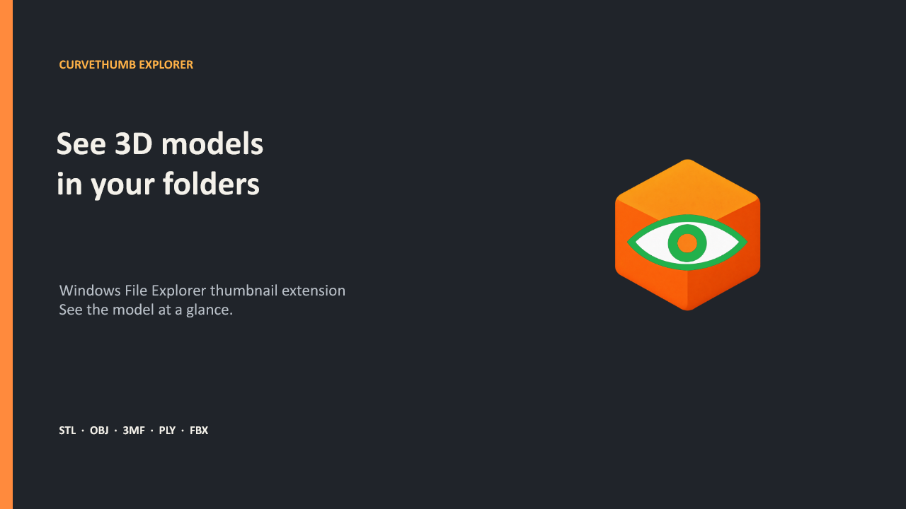
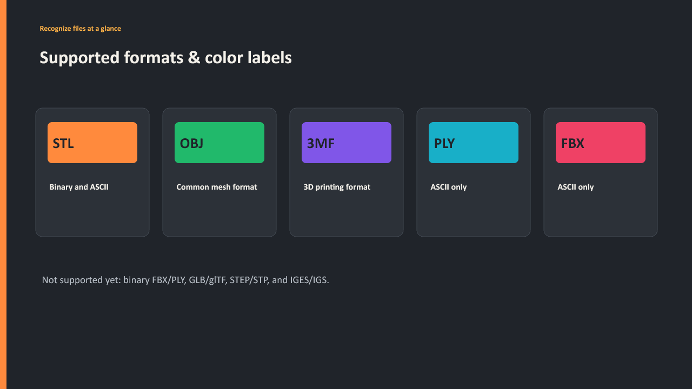
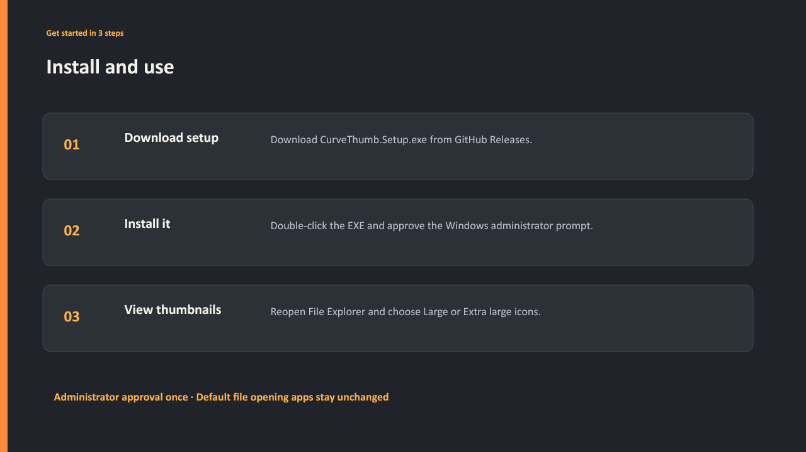
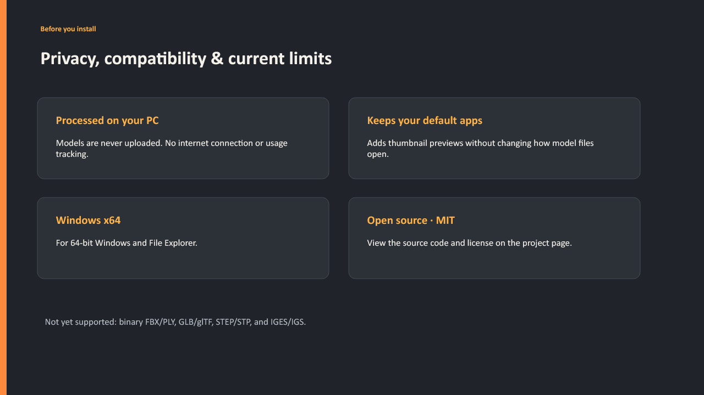

# CurveThumb Explorer: visual overview

See 3D models directly in Windows File Explorer. The gallery shows the supported formats, an English before/after example, installation steps, and current limits.

