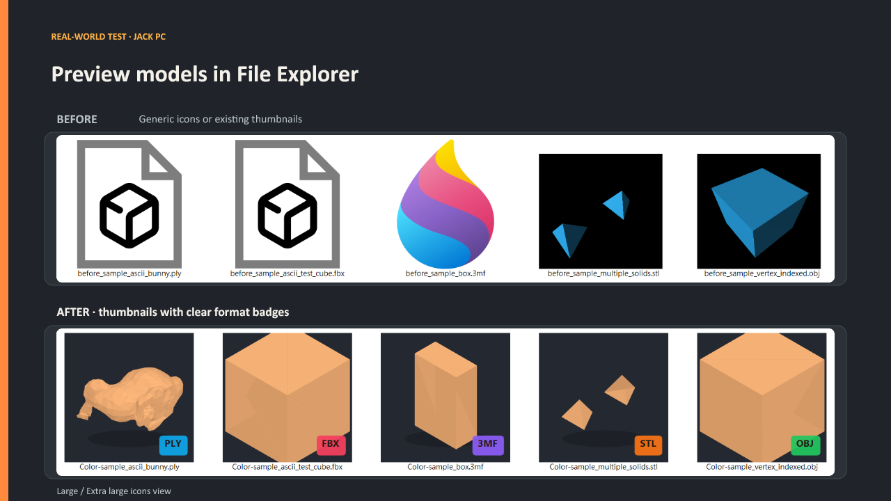

# CurveThumb Explorer

**Preview 3D models directly in Windows File Explorer.** Browse your model folders in Large or Extra large icons view to see a thumbnail and a small format label beside each supported file. No separate viewer is required.

## See it in File Explorer

The 3D shape appears in the folder itself, with a colored file format badge. Double-clicking a model still opens your usual default app.

[See the full illustrated overview](OVERVIEW.md).

## Supported formats

The built-in thumbnail provider currently supports binary and ASCII STL, OBJ, 3MF, ASCII PLY, and ASCII FBX. Binary FBX, binary PLY, GLB/glTF, STEP/STP, and IGES/IGS are not supported yet. File Explorer will continue to show its regular icon or another installed thumbnail provider for unsupported files. STEP and IGES surface models require a dedicated CAD geometry engine for reliable tessellation.

## Install in three steps

1. **Download:** [CurveThumb.Setup.exe](https://github.com/jack7534/curve-thumb-explorer/releases/download/v1.2.1/CurveThumb.Setup.exe) from the [v1.2.1 release](https://github.com/jack7534/curve-thumb-explorer/releases/tag/v1.2.1). The ZIP package is also available there for offline sharing.
2. **Install:** Double-click the EXE and approve the Windows administrator prompt. Wait for the “CurveThumb Explorer is installed” message.
3. **View:** Close and reopen File Explorer. Open a folder with models and choose **View → Large icons** or **Extra large icons**.

No separate viewer needs to stay open. To check the installation, use the included `Sample-Tetrahedron.stl` from the ZIP.

For cloud files that show a cloud icon, download the model locally or choose **Available offline** before expecting a preview. Windows cannot render a thumbnail while the model data is only online.

Windows SmartScreen may show an unknown publisher notice for a new free and open-source utility. Download only from this project's GitHub Releases page and verify the published SHA-256 checksum.

### If the icons are still blank

- Confirm you selected **Large icons** or **Extra large icons**, then reopen the folder.
- For cloud-only files, choose **Available offline** so Windows can read the model data.
- Re-run the latest installer to refresh old thumbnails. Setup clears Windows' thumbnail cache once and reopens File Explorer; the first visit to a folder may take longer while previews rebuild.
- Binary STL now uses a bounded preview for dense meshes. Small models still render every face, while larger files sample a fixed number of spatial blocks so thumbnail work no longer grows linearly with file size. This is designed for large ZBrush and scan exports where Explorer only needs a fast visual identifier. Other supported formats must be at most 128 MiB.

## Uninstall

Open **Windows Settings → Apps → Installed apps**, find **CurveThumb Explorer**, and choose **Uninstall**. If another machine-wide thumbnail handler was registered for the same format before installation, setup restores it.

## Privacy and compatibility

- Model files are processed locally. The tool does not connect to the internet, upload models, or collect usage data.
- Setup registers the thumbnail handler for this computer. The default app associated with `.stl`, `.obj`, and other model files is not changed.
- Requires 64-bit Windows and administrator approval during installation. Thumbnail rendering runs in Windows' isolated Shell process.
- Only the formats listed above are registered. Unsupported formats remain under Windows or other installed thumbnail providers.
- Large binary STL files use a bounded, low-overhead preview path instead of rasterizing every triangle. Windows keeps thumbnails in its shared cache, rather than creating a separate image file beside each model. Setup clears the old cache on installation or upgrade. To refresh it later, run the installed `CurveThumb.Setup.*.exe /refresh-cache` as administrator. This refreshes thumbnails for all file types in the current Windows account; previews rebuild as folders are opened.

## Performance notes

- Small binary STL meshes render at full surface fidelity.
- Dense STL meshes switch to a bounded preview path after 250,000 triangles.
- Large-model preview work is capped to sampled blocks instead of scaling with every triangle in the file.
- Large previews use a lower internal oversampling target because Explorer thumbnails are typically only 96–256 px.
- The renderer fills only small local gaps, helping sampled previews remain visually solid without welding separated parts together.

> The packaged GitHub Release remains v1.2.1 until the v1.3.0 build is validated and published. The `main` branch contains the new large-STL performance work.

## Build from source

Run `build.ps1` on Windows with the .NET Framework 4.x compiler available. The script builds the x64 Shell provider, a single-file setup EXE, and the distributable ZIP in `dist/`.

## License

MIT. See [`LICENSE`](LICENSE).
